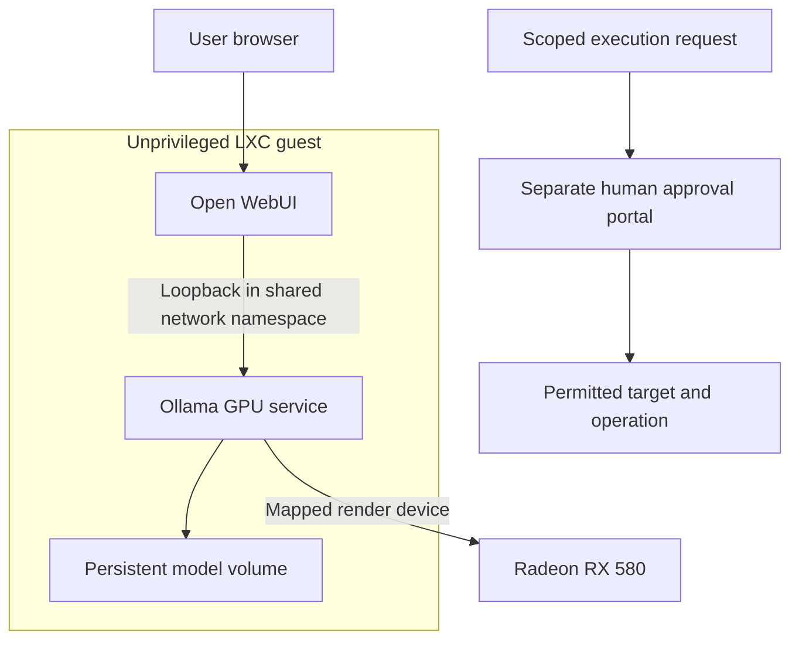

[← Local AI](README.md)

# Architecture and operation

## Recorded deployment

| Layer | Recorded configuration |
| --- | --- |
| Virtualization | Proxmox VE |
| Host CPU and RAM | Intel Core i5-8400, six physical cores, 24 GB RAM |
| AI guest | Unprivileged LXC, four allocated CPUs, 8 GB RAM |
| Application | Open WebUI in Docker |
| Inference | Separate Ollama 0.40.2 service using Vulkan |
| GPU | Radeon RX 580, measured 4 GiB VRAM |
| Model | Local coding alias based on Qwen3 4B Instruct, Q4_K_M |
| Context | 8,192 tokens |
| Concurrency | One parallel inference request configured |

Versions and resources are historical observations from October 19, 2026.

## Request flow

The approval path is a separate control workflow. The diagram does not imply that a model response can directly administer the host.

## GPU transfer

The RX 580 was reassigned from a Windows VM to the local AI environment. The Windows VM remained stopped and no longer had the physical GPU assigned. The two environments were not sharing full PCI passthrough.

Measured VRAM was 4 GiB despite a misleading PCI subsystem product label. The model used partial offload: the final residency report was approximately 18% CPU and 82% GPU.

Existing model weights, chat histories, application volumes, and the context limit were retained. The original embedded CPU inference service remained available as a fallback.

## Operational lessons

- GPU render-device numbering can change after a host reboot or hardware changes. Recheck both the LXC device entry and Docker device mapping together.
- Recreating Open WebUI requires recreating or restarting the GPU service so it joins the replacement container's network namespace.
- Two inference services can see the same model storage. Avoid simultaneous model-management changes through both.
- A service restart and a full host boot are different validation steps. Full host boot validation remains outstanding in the saved transfer notes.
